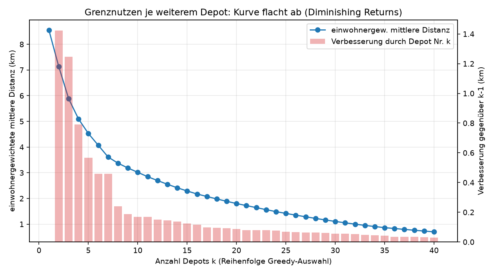
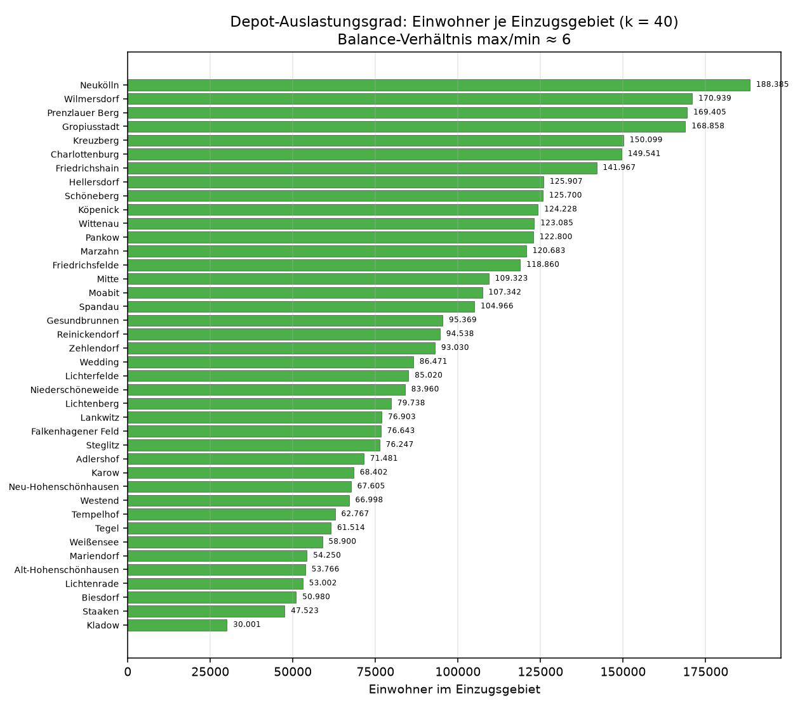
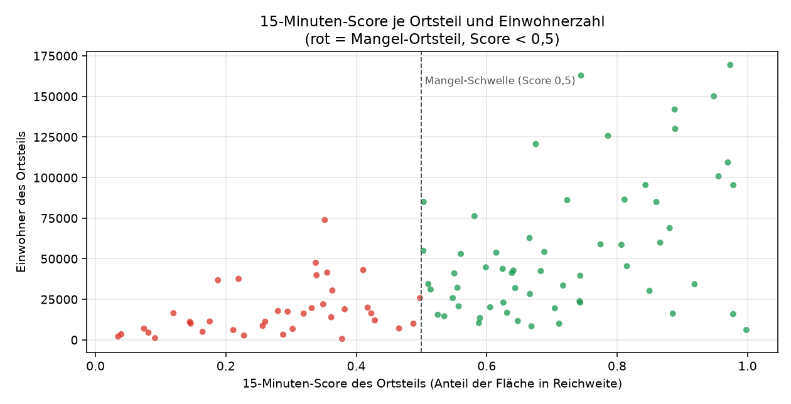
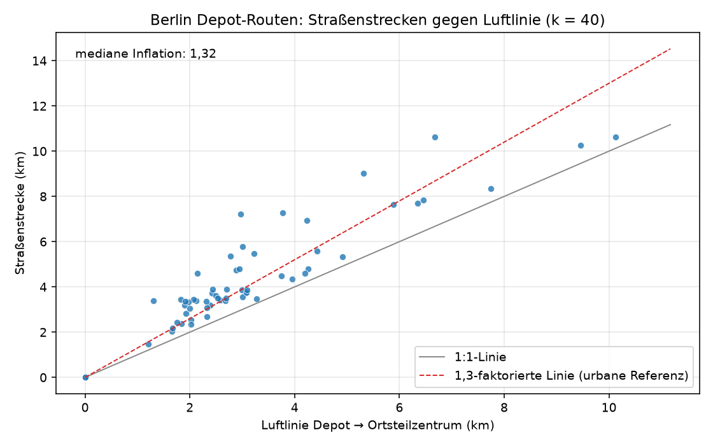

# KiezRouter – Depot-Standortauswahl & Routenplaner Berlin

Ein Paketdienst plant ein Depotnetz für Berlin. Das Projekt beantwortet zwei
Fragen vollständig in SQL (DuckDB mit Spatial-Extension):

1. **Wo liegen gute Depotstandorte?** Bei vorgegebener Depotanzahl *k* werden die
   Standorte gewählt, die die **einwohnergewichtete mittlere Distanz** zwischen
   Ortsteilzentrum und Depot minimieren (Greedy-p-Median, Szenarien mit k = 20
   und k = 40).
2. **Wie gut ist die Autobahnanbindung?** Für jeden Ortteil wird der Abstand zum
   nächsten Autobahnsegment (`motorway`/`motorway_link`) berechnet und die
   Bevölkerung pro 2-km-Band ausgewertet.

Einheiten sind die **97 Berliner Ortsteile** (die amtliche Ebene ist feiner als
Bezirke); die Bezirkszugehörigkeit wird als räumlicher Join mitgeführt. Alle
Geometrieoperationen (`ST_Read`, `ST_Transform`, `ST_Contains`, `ST_Distance`,
`ST_Centroid`, `ST_AsGeoJSON`, …) laufen in SQL. Python orchestriert nur den
Ablauf (Variablen, Greedy-Loop, Export); die eigentliche Analyse ist SQL.

## Schnellstart

```bash
python3 -m venv .venv
.venv/bin/pip install -r requirements.txt
bash data/download.sh                       # Rohdaten (~140 MB) laden
.venv/bin/python scripts/run_pipeline_berlin.py    # Analyse
.venv/bin/python scripts/make_berlin_visuals.py    # Diagramme + Karte
```

Ergebnisse liegen unter `outputs/`.

## Datenquellen

| Quelle | Inhalt | Lizenz |
|---|---|---|
| Geofabrik OSM-Extract Berlin: `gis_osm_adminareas_a_free_1` (Bezirks- und Ortsteilgrenzen) und `gis_osm_roads_free_1` (Straßen) | Grenzen; Autobahnsegmente | ODbL – © OpenStreetMap-Mitwirkende |
| Amt für Statistik Berlin-Brandenburg, Einwohnerregisterstatistik SB_A01-05-00 (XLSX), Tabelle „nach Ortsteilen" | Einwohner je Ortsteil (Stichtag 30.06.2026) | CC BY 3.0 DE |

Download beider Quellen: `bash data/download.sh` (die XLSX-URL wird
automatisch aus der Veröffentlichungsseite gelesen – Stichtag dort prüfen).
Grenz- und Bevölkerungsebene werden über die Ortsteilnamen verknüpft;
der Treiber bricht ab, wenn Ortsteile ohne Einwohnerzahl bleiben.

## Methode

1. **Load** (`sql/b01_load.sql`): Bezirks- und Ortsteilgrenzen aus dem
   OSM-Extract filtern (Berlin-Inselumfang), projizieren auf EPSG:25833
   (UTM-Zone 33, korrekt für Berlin), populieren mit den amtlichen
   Einwohnerzahlen je Ortsteil (XLSX → CSV → Tabelle `ortsteile`).
2. **Prepare** (`sql/b02_prepare.sql`): Abstand Ortsteilzentrum → nächstes
   Autobahnsegment in km.
3. **Standortwahl** (Python, `scripts/run_pipeline_berlin.py`): Greedy-p-Median
   auf der 97-×97-Distanzmatrix; neu gewählt wird der Kandidat, der die
   einwohnergewichtete mittlere Distanz am stärksten senkt.
4. **Zuordnung und Kennzahlen** (`sql/b03_allocation.sql`, `sql/b04_metrics.sql`):
   Jeder Ortsteil wird dem nächstgelegenen gewählten Ortsteil-Depot zugeordnet;
   je Szenario entstehen eine Kennzahlentabelle, Einzugs-Kennzahlen je Depot
   und die Liste am schlechtesten abgedeckter Ortteile.

## Ergebnisse (Stand dieses Repos)

| Szenario | Einheiten | Depots | EWZ gesamt | gew. mittl. Distanz | max. Distanz | % EWZ ≤ 5 km | Autobahn ≤ 5 km |
|---|---|---|---|---|---|---|---|
| k = 20 | 97 (Ortsteile) | 20 | 3.917.196 | **1,8 km** | 9,5 km | 93,5 % | 76,1 % |
| k = 40 | 97 (Ortsteile) | 40 | 3.917.196 | **0,7 km** | 7,9 km | 99,0 % | 76,1 % |

Quersummen-Prüfung (amtlich): 97 Ortsteile ergeben exakt 3.917.196 Einwohner –
identisch mit dem amtlichen Berlin-Gesamtwert im Statistik-Bericht.

Beim Übergang von k = 20 zu k = 40 halbiert sich die einwohnergewichtete
Distanz nahezu; das Netz verdichtet sich vor allem innenstadtnah und im
Südkorridor (Neukölln, Gropiusstadt, Lichtenrade).






## Was das für das Geschäft bedeutet (Business Insights)

Die Abdeckungskarte zeigt das Netz; die Kennzahlen-Tabellen und
zusätzlichen Diagramm-Auswertungen ziehen daraus Einscheidungen. Alles ist als
CSV/Diagramm im Repository enthalten:

1. **Standortzahl mit Grenznutzen-Schwelle** (`B40_greedy_verlauf.csv`,
   Chart `grenznutzen.png`): das erste Depot senkt die einwohnergewichtete
   Distanz auf 8,6 km; das zweite bringt noch 1,42 km; ab dem 20.
   Depot liegt der Schrittgewinn unter 0,09 km und beim 40.
   Depot unter 0,03 km. Jede Ausbaustufe über k ≈ 20 hinaus ist damit zu
   bewerten als Kosten-Nutzen-Abwägung, nicht als Deckungslücke.
2. **Personal- und Flächenauslastung je Depot** (`B40_depot_stats.csv`,
   Chart `auslastung.png`): mit k = 40 liefert Neukölln das größte Einzugsgebiet
   (188.385 Einwohner) gefolgt von Wilmersdorf (170.939) und Prenzlauer Berg
   (169.405); das kleinste (Kladow, 30.001) trägt nur ein Sechstel davon.
   Das Verhältnis von größtem zu kleinem Einzugsgebiet liegt bei ≈ 6 – direkt
   nutzbar für Tourenplanung, Schichtgrößen und Lagerfläche je Depot.
3. **Risiko-Ortsteile** (`B40_risiko_ortsteile.csv`): zugleich weit vom Depot
   und weit von der Autobahn – hier hilft ein zusätzliches Depot am meisten.
   Bei k = 40 sind es exakt 3 Ortsteile im Südosten: Rahnsdorf
   (6,7 km Depot / 10,8 km Autobahn / 11.237 Einw.), Müggelheim
   (6,5 / 8,2 / 6.993) und Schmöckwitz (7,9 / 6,3 / 4.501).
4. **Keine Erschließungslücke bei k = 40** (`B40_unterversorgt.csv`): die
   Defizitliste (Schwelle 8 km) ist leer; der schlechteste Ortsteil liegt
   bei 7,9 km (Schmöckwitz). Bei k = 20 liegen dagegen Ortsteile mit
   Entfernungen bis 9,5 km – k = 40 schließt diese Netzlücke.


Interaktive Kartenvarianten: `outputs/maps/einzugsgebiete_b40.html` und
`einzugsgebiete_b20.html` (Basiskarte standardmäßig Esri Grau, per
Ebenenschalter OpenStreetMap-DE aktivierbar; Hinweis unten bezüglich Tiles).

Hinweis: Hintergrund-Tiles kommen von externen Servern; OpenStreetMap kann bei
intensiver Nutzung mit „403 Access blocked" antworten
([osm.wiki/Blocked](https://osm.wiki/Blocked)). Polygone, Depots und
Kennzahlen sind davon unabhängig und die statische Kartengraf oben ist
vollständig offline nutzbar.

## Einschränkungen

* **Datenstand der Grenzen:** OSM-Extract der Geofabrik; Bezugsdatum der
  Veröffentlichung deckt sich nicht exakt mit dem Stichtag der Bevölkerung
  (30.06.2026, Melderegister).
* **Distanz = Luftlinie** zwischen Ortsteilzentren, keine Straßenroute; absolute
  Werte sind daher optimistisch, Szenario-Vergleiche (k = 20 vs. 40) bleiben
  aussagekräftig, weil beide Szenarien dieselbe Metrik verwenden.
* **Depots sind Punktmodelle** mit Kandidaten „Ortsteil-Zentroid": keine
  Prüfung von Flächenverfügbarkeit, Preis, Baurecht oder Flächennutzung.
* **Greedy-p-Median** garantiert keine globale Optimalität; die Auswahl ist
  reproduzierbar (deterministische Reihenfolge) und liefert eine zulässige
  Näherungslösung.
* Autobahnnähe bezieht sich nur auf Segmente **innerhalb Berlins**; der A 10
  verläuft überwiegend außerhalb der Landesgrenze und ist nicht enthalten.

## Projektstruktur

```
sql/b01_load.sql           Grenzen + amtliche Einwohnerzahlen persistieren
sql/b02_prepare.sql        Autobahndistanz je Ortsteil
sql/b03_allocation.sql     Ortsteil -> nächstes Depot je Szenario
sql/b04_metrics.sql        Kennzahlen je Szenario
sql/d01_15min_load.sql     POI/Schiene-Kategorien (15-Minuten-Stadt)
sql/d02_15min_score.sql    Buffer-Vereinigung, Flächenanteile, Mangel-Liste
sql/e01_filter_roads.sql   Fahrzeugkanten (Routenanalyse): Länge + Zeitkosten
scripts/run_pipeline_berlin.py   Treiber Depot-Analyse
scripts/run_pipeline_15min.py    Treiber 15-Minuten-Stadt
scripts/run_pipeline_routen.py   Treiber Routenanalyse (Graph + Dijkstra)
scripts/make_berlin_visuals.py   Diagramme + Karten Depot-Analyse
scripts/make_15min_visuals.py    Karte + Verteilung 15-Minuten-Stadt
scripts/make_routen_visuals.py   Inflation, Abdeckung, Fahrzeit-Karte
scripts/make_strassenmap.py      Straßennetz-Karte (statisch + interaktiv)
scripts/route_app.py             Routenplaner-App (lokal, Port 8777)
scripts/route_app.html           Frontend der Routenplaner-App
scripts/build_address_index.py   Adressindex aus OSM-PBF (Pyosmium)
outputs/data/              CSV-Ergebnisse aller Analysen
outputs/charts/            abdeckungskurve, grenznutzen, auslastung, score_verteilung, routen_…
outputs/maps/              statische PNGs + interaktive HTML-Karten
  · strassennetz_statisch.png — alle 464.992 OSM-Ways, dunkles Styling;
    gestrichelt-weiß + Richtungspfeile = Einbahn-Ways (F/T, Fahrzeugklassen)
  · strassennetz.html — interaktiv: Autobahnen bis Bundesstraßen farbig +
    ~31.300 Einbahn-Overlays (weiß gestrichelt, Canvas-Renderer)
data/                      Rohdaten (nicht im Git, siehe data/download.sh)
```

## „15-Minuten-Stadt" – Alltagsversorgung in Gehreichweite

Zweites Geschäftsdataset aus denselben Quellen: Wie viel Fläche und wie viele
Einwohner erreichen je Ortsteil die Alltagskategorien in <= 15 Gehminuten?

- **Kategorien:** Supermarkt (884), Apotheke (665), Klinik (137), Schule (118),
  schienengebundener ÖPNV (`railway_station` 287, `tram_stop` 916).
- **GIS-Mechanik:** `ST_Buffer(geom, 1100)` je Kategorie (1100 m Luftlinie ≈
  15 Gehminuten), `ST_Union_Agg` zum verschmolzenen Reichweite-Netz,
  `ST_Intersection` + `ST_Area` → Flächenanteil je Ortsteil.
- **Score:** gemittelter Flächenanteil der 5 Kategorien, je Ortsteil.

Stadtweit (einwohnergewichtet):

| Kategorie | Anteil der Einwohner in Gehreichweite |
|---|---|
| Supermarkt | 86,0 % |
| Apotheke | 86,2 % |
| Klinik/Praxis | 47,9 % |
| Schule | 46,5 % |
| Schienen-ÖPNV | 78,9 % |
| **Score (Mittel der 5 Kategorien)** | **69,1 %** |




**Mangel-Ortsteile** (`mangel_ortsteile_15min.csv`): 38 Ortsteile mit
679.351 Einwohnern (17,3 % der Stadt) fallen unter die Score-Schwelle 0,5 –
konzentriert in den Randzonen: Hakenfelde (Score 0,19, 36.782 Einw.),
Tegel (0,22/37.607), Staaken (0,34/47.523), Kladow (0,12/16.459),
Grunewald (0,14/11.122), Mahlsdorf (0,36/30.461), Köpenick (0,35/73.921).
Der Verteilungs-Chart zeigt zusätzlich: die Mangel-Ortsteile sind eher
klein; die Mehrheit der Einwohner lebt in den stark abgedeckten
zentralen Ortsteilen.

**Geschäftsnutzen:** Die Mangel-Ortsteile bilden die Versorgungs-Kurzliste
für Handelsketten und Investoren. Immobilienbewertungen können den Score
als Standortfaktor je Ortsteil einsetzen. Die Stadtplanung erhält einen
Messwert gegen die 15-Minuten-Empfehlung auf Ortsteil-Ebene.

### Einschränkungen der 15-Minuten-Analyse

* „15 Gehminuten" = 1100 m Luftlinie; reale Fußwege entlang des Straßennetzes
  sind länger (typischer Faktor 1,2 bis 1,3), der Score ist damit optimistisch.
* POI-Grundlage sind ausschließlich die fclasses des Geofabrik-Extracts.
  Die Klasse `doctor` existiert im Extract nicht; die Kategorie
  „Klinik/Praxis" beruht auf `clinic` (137 Knoten).
* `bus_stop` (6.498 Haltestellen) wurde bewusst ausgeschlossen: ihre
  flächendeckende Dichte würde die ÖPNV-Kategorie überall nahe an 100 % setzen
  und aussagelos machen.
* Der Anteil bezieht sich auf Fläche, nicht auf Einwohner: innerhalb einer
  Ortsteilfläche wird gleichverteilte Bevölkerung angenommen.

## Routenanalyse: echte Straßenrouten statt Luftlinie

Die Depot-Analyse (Luftlinie) wird hier um ein **routierbares Straßennetz**
ergänzt: Der OSM-Roads-Layer wird zu einem Graph aus 664.228 Kanten
und 633.167 Knoten aufbereitet (nur Fahrzeugklassen, EPSG:25833, Länge und
Zeitkosten je Teilkante aus `maxspeed` bzw. Klassen-Defaults). Einbahn-Semantik
wird empirisch geklärt: `F` = nur vorwärts (trifft auf alle 706
Autobahn-Rows zu), `B` = beidseitig, `T` = nur vorwärts (17 Kanten,
z. B. Oberwasserstraße, Anzengruberstraße); 15,7 % der Kanten sind einseitig
nur in einer Fahrtrichtung. Größte zusammenhängende Komponente: 98,6 % der Knoten.
Prüfung im Verlauf: bei allen 104.252 einseitigen Kanten (darunter
beispielhaft `Auerstraße`, 22 Segmente) existiert die rückwärtige Kante im
Graph nicht (0 Verstöße, Ausnahme: 2 gegenläufige separate Service-Ways mit
identischen Knotenpunkten – physikalisch gegenläufige Zufahrten).

Je Depot-Szenario (k = 20 / 40) läßt der Treiber für **jedes Depot einmal**
Dijkstra laufen und liest daraus die Fahrzeit aller 97 Ortsteile ab:

- **Inflation:** medianer Faktor Straßenstrecke je Luftlinie = **1,32**
  (Chart `routen_inflation.png`) im erwarteten urbanen Band (1,2–1,6).
- **Zeitmodell:** Geschwindigkeit = maxspeed ×
  Verkehrs-Faktor (0,85 Autobahn, 0,60 Stadtstraßen), **plus** Knoten-Verzögerung
  8 s an Kreuzungen (Grad ≥ 3). Damit kein reines „freies Fahren"-Modell:
  Ampellwirkung und innerstädtischer Verlauf werden modelliert. Kein
  Tagesprofil, keine Turn-Restrictions und keine Sperrungen.
- **Fahrzeit-Abdeckung** (`routen_<Szenario>_abdeckung.csv`,
  Chart `routen_abdeckung.png`):

| Szenario | ≤ 15 min | ≤ 30 min | ≤ 45 min |
|---|---|---|---|
| k = 20 | 83,7 % | 98,8 % | 100 % |
| k = 40 | 94,5 % | 99,3 % | 100 % |




Direkter Vergleich zur Luftlinien-Methodik: mit k = 20 lag der einwohner-
gewichtete Luftlinien-Abstand bei 1,8 km, während selbst in
Fahrzeit-Sicht bereits 99,5 % der Einwohner innerhalb von 15 Minuten liegen.
Die relevanten Differenzen treten an den Randzonen auf (Wannsee 11 min,
Rahnsdorf 14 min, Blankenfelde 11 min): dort unterschätzt die Luftlinie
Umleitungen über Wasser- und Grünflächen deutlich, die Straßenrouten
decken die reale Fahrgeografie ab.

**Brücken- und Tunnel-Abhängigkeit** (`routen_<Szenario>_bruecken_tunnel.csv`):
pro Szenario werden die Kanten auf den Dijkstra-Kürzestenpfaden erkannt, die als
Brücke bzw. Tunnel verzeichnet sind, gewichtet mit den davon betroffenen
Einwohnern: ein Prioritätsplan für Baustellen-Umleitungen und
Netz-Risiko-Bewertung. **Business-Nutzen:** Tourenplanung und
Netz-Ausbauplanung – Depotstandort gegen reale Straßen-Umleitungskosten.

### Einschränkungen Routenanalyse

* Der Graph kommt aus dem Shapefile ohne Turn-Restrictions und ohne
  Zugangsbeschränkungen; das Zeitmodell ist vereinfacht
  (Geschwindigkeitsfaktor + Knoten-Verzögerung): kein Tagesprofil, keine
  simulierte Ampelphasen, keine Sperrungen (Baustellen, Unfälle).
* 1,4 % der Knoten liegen außerhalb der größten Komponente; deren
  Ortsteil-Zentroiden werden über den sehr nächsten Knoten des
  Haupt-Komponents angebunden.
* `bridge`/`tunnel` basieren auf der OSM-Klassifizierung des Extracts, ohne
  externen Fakten-Abgleich.

## Routenplaner-App (interaktiv)

Für einzelne Routen gibt es einen lokalen Webserver mit Karte, ohne neue
Abhängigkeiten (stdlib `http.server`):

```bash
.venv/bin/python scripts/route_app.py
# Browser: http://127.0.0.1:8777
```

- Start/Ziel per Dropdown (97 Ortsteile) oder **direkt auf der Karte klicken**
  (erster Klick = Start, zweiter = Ziel).
- Ergebnis: Distanz (km), Fahrzeit (min), Inflation zur Luftlinie und die
  **Straßenliste der Route** inklusive Brücke-/Tunnel-Markierung.
- Die Route wird farbig auf der Karte dargestellt (Markierung: grün = Start,
  rot = Ziel), Basiskarte standardmäßig „Esri Dunkel", OSM-DE wählbar.
- Der Graph wird beim Start einmal geladen (dauert einige Sekunden bis
  eine Minute); danach antwortet jede Routenabfrage in ca. 1–2 Sekunden.
- Der Server bindet auf `127.0.0.1` (lokal, kein Netz-Expose) und nutzt
  Port 8777.

**Adress-Routing (Straße + Hausnummer):** Das Feld „Start-/Ziel-Adresse"
sucht im lokalen Adressindex (**333.100 Adressen, 9.080 Straßen** aus
`berlin-latest.osm.pbf`, Tabelle `adressen` der Depot-Datenbank – Aufbau mit
`scripts/build_address_index.py`, Datenbezug siehe `data/download.sh`).
Bei Eingabe ≥ 3 Zeichen erscheinen bis zu 5 Vorschläge mit Ortsteil-Hinweis;
die Auswahl setzt die Koordinaten, danach läuft die Route identisch über
Straßennetz-Knoten. Geocodierung bleibt vollständig lokal (keine Abfrage
externer Dienste). OSM deckt den Großteil der Häusernummern ab, aber nicht
alle – Fallback bleibt die Kartennennung per Klick.

## Routenplaner (KiezRouter-App)

Interaktive Web-App für Routenplanung auf dem OSM-Straßennetz von Berlin, mit
Adresssuche, U/S-Bahn-Stationen als POIs, Multi-Stop-Routing und Auto/Fuß-Modus.

```bash
.venv/bin/python scripts/route_app.py            # HTTP, http://127.0.0.1:8777
.venv/bin/python scripts/route_app.py --https    # HTTPS, https://127.0.0.1:8443 (nötig für GPS am Handy)
```

Features:
- Adresssuche mit Autocomplete (inkl. ß/ss-Normalisierung, Hausnummer-Priorisierung)
- U-Bahn- und S-Bahn-Stationen als durchsuchbare POIs
- Multi-Stop-Routing mit Drag-and-Drop (bzw. ↑/↓) der Punkte
- Auto- und Fußgänger-Modus (getrennte Graphen)
- Karte mit Start/Ziel/Stop-Markern, Straßenliste, GPX-Export, Share-Link
- Mobil-optimiertes Layout (Bottom Sheet), GPS-Standort

Voraussetzung: `data/berlin/` mit Geofabrik-Extract und `depot_berlin.duckdb`
(inkl. `adressen`- und `stationen`-Tabellen). Aufbau:
```bash
.venv/bin/python scripts/build_address_index.py
.venv/bin/python scripts/build_station_index.py
```

## Quellenvermerk / Attribution

Grenz- und Straßendaten © OpenStreetMap-Mitwirkende, verfügbar über die
[Geofabrik](https://download.geofabrik.de)-Extracts (ODbL).
Einwohnerzahlen © Amt für Statistik Berlin-Brandenburg
(Einwohnerregisterstatistik SB_A01-05-00, CC BY 3.0 DE).
Basiskarten der interaktiven Ansicht: Tiles © Esri (World Gray Canvas,
Quellen: Esri, USGS); alternativ © OpenStreetMap-Mitwirkende (FOSSGIS-Server).
