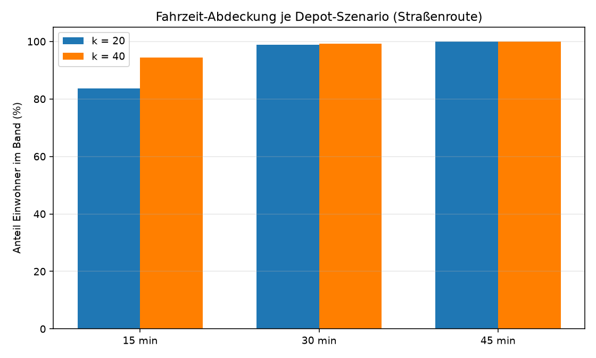

# KiezRouter – Interaktiver Routenplaner für Berlin

Web-App für Routenplanung auf dem OSM-Straßennetz von Berlin: Adresssuche,
U/S-Bahn-Stationen als POIs, Multi-Stop-Routing, Auto- und Fußgänger-Modus,
mobil-optimiert, offline-fähige Geocodierung.



## Schnellstart

```bash
python3 -m venv .venv
.venv/bin/pip install -r requirements.txt
bash data/download.sh                       # Rohdaten (~140 MB) laden
.venv/bin/python scripts/build_address_index.py   # Adressindex (~330 k Adressen)
.venv/bin/python scripts/build_station_index.py   # U/S-Bahn-Stationen (~345)
.venv/bin/python scripts/route_app.py              # HTTP  -> http://127.0.0.1:8777
.venv/bin/python scripts/route_app.py --https     # HTTPS -> https://127.0.0.1:8443 (nötig für GPS am Handy)
```

## Features

- **Adresssuche** mit Live-Autocomplete: ß/ss-Normalisierung, Hausnummer-Priorisierung, Deduplizierung
- **U-Bahn- und S-Bahn-Stationen** als durchsuchbare POIs (in derselben Suchleiste)
- **Multi-Stop-Routing**: beliebig viele Zwischenstopps, Drag-and-Drop bzw. ↑/↓ zum Umsortieren
- **Auto- und Fußgänger-Modus**: getrennte Graphen (Auto: Kfz-Klassen + Einbahn; Fuß: Fußwege, Pfade, Treppen, bidirektional)
- **Karte**: Start/Ziel/Stop-Marker (farbig nummeriert), Route, Straßenliste, Brücken/Tunnel-Markierung
- **Export**: GPX-Download, Link kopieren, Share-URL mit Hash
- **Letzte Routen** (localStorage)
- **Mobil-optimiert**: Bottom Sheet, 44 px Touch-Targets, GPS-Standort, Karten-Zentrierung oberhalb des Menüs
- **HTTPS**: selbstsigniertes Zertifikat mit LAN-IP im SAN (für GPS auf dem Handy)
- **Offline-Geocodierung**: keine externen Dienste, alles lokal aus dem OSM-PBF

## Architektur

```
scripts/route_app.py          Flask-loses http.server-Backend (JSON-API)
scripts/route_app.html        Frontend (Leaflet, vanilla JS)
scripts/build_address_index.py OSM-PBF -> adressen-Tabelle (DuckDB)
scripts/build_station_index.py OSM-PBF -> stationen-Tabelle (DuckDB)
scripts/run_pipeline_routen.py Routierbarer Graph (Auto/Fuß, Dijkstra, CSV-Outputs)
sql/e01_filter_roads.sql      Fahrzeugtaugliche Klassen (EPSG:25833)
sql/e01_filter_roads_walk.sql  Fußgängertaugliche Klassen
data/berlin/                  Rohdaten (gitignored) + DuckDBs + Graph-Caches
```

## Datenquellen

| Quelle | Inhalt | Lizenz |
|---|---|---|
| Geofabrik OSM-Extract Berlin: `gis_osm_roads_free_1`, `gis_osm_transport_free_1` | Straßennetz, Stationen | ODbL – © OpenStreetMap-Mitwirkende |
| Geofabrik OSM-PBF `berlin-latest.osm.pbf` | Adressen, Stationen (Tags) | ODbL |
| Amt für Statistik Berlin-Brandenburg (SB_A01-05-00) | Einwohner je Ortsteil | CC BY 3.0 DE |
| BKG VG250-EW | Bezirks-/Ortsteilgrenzen | dl-de/by-2-0 |

Download: `bash data/download.sh` (XLSX-URL wird automatisch gelesen).

## Depot-Standortanalyse (SQL + GIS)

Zusätzlich enthält das Repo eine SQL/GIS-Analyse zur Depot-Standortwahl in
Berlin (Ortsteil-Ebene, DuckDB Spatial): Greedy-p-Median für k = 20/40,
Autobahnanbindung, 15-Minuten-Stadt, Routenanalyse mit Dijkstra. Ergebnisse
und Diagramme liegen unter `outputs/`. Details und Kennzahlen siehe
`sql/` und `scripts/run_pipeline_*.py`.

## Quellenvermerk / Attribution

Grenz- und Straßendaten © OpenStreetMap-Mitwirkende, verfügbar über die
[Geofabrik](https://download.geofabrik.de)-Extracts (ODbL).
Einwohnerzahlen © Amt für Statistik Berlin-Brandenburg
(Einwohnerregisterstatistik SB_A01-05-00, CC BY 3.0 DE).
Basiskarten: Tiles © Esri; alternativ © OpenStreetMap-Mitwirkende (FOSSGIS).